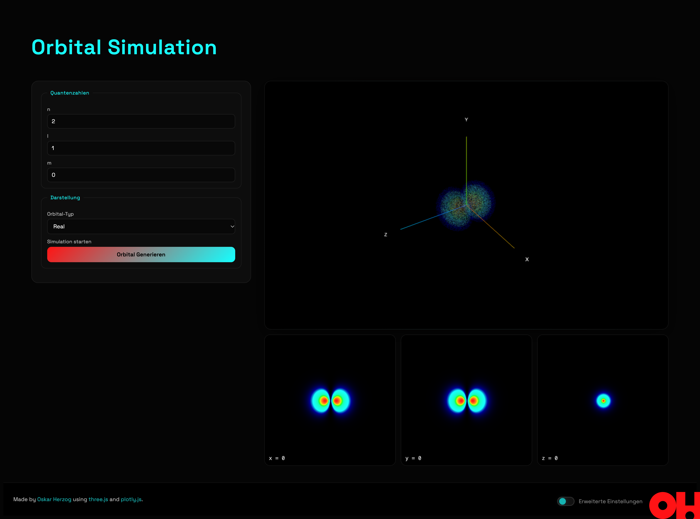
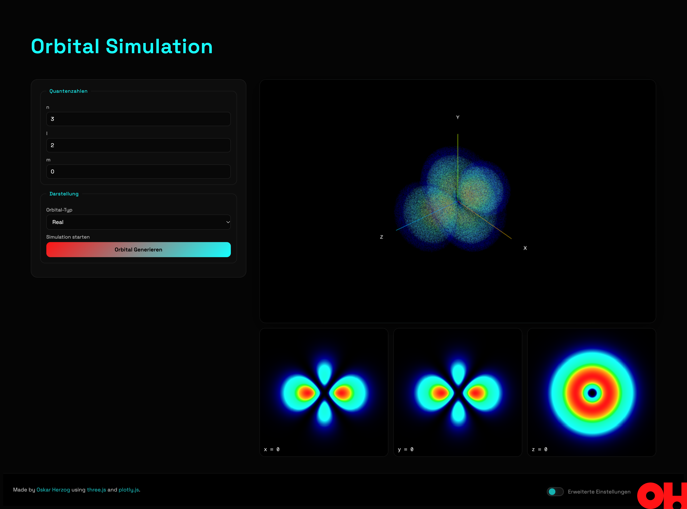

# Hydrogen Orbital Simulation

A web-based hydrogen orbital simulator that visualizes quantum-mechanical wavefunctions as interactive 3D probability clouds and 2D cross-sectional heatmaps. Built with JavaScript, Three.js, and Plotly.

**Live demo:** https://odukecp.github.io/Orbital-Simulation/

## Table of Contents

- [Features](#features)
- [Functionality](#functionality)
    - [Initialization](#initialization)
    - [Config readout](#config-readout)
    - [Generation of a 3D grid](#generation-of-a-3d-grid)
    - [Reduction of the points](#reduction-of-the-points)
    - [Wavefunction application](#wavefunction-application)
    - [Normalization and threshold](#normalization-and-threshold)
    - [3D visualization](#3d-visualization)
    - [2D heatmaps](#2d-heatmaps)
- [Physics Background](#physics-background)
- [Installation](#installation)
- [Usage](#usage)
    - [Advanced settings](#advanced-settings)
- [Build](#build)
- [Project Structure](#project-structure)
- [Screenshots](#screenshots)
- [Motivation](#motivation)
- [Future Ideas](#future-ideas)
- [Contributing](#contributing)
- [License](#license)

## Features

- Interactive **3D point cloud** of the probability density |ψ|², rotatable and zoomable, with automatic rotation
- Three **2D heatmaps** of the cross-sections `x = 0`, `y = 0` and `z = 0`
- **Real and complex orbitals** (e.g. p<sub>x</sub>/p<sub>y</sub>/p<sub>z</sub> instead of m = ±1)
- Color scale based on the logarithm of the normalized value (blue = low, red = high)
- Validation of the quantum numbers (`n ≥ 1`, `0 ≤ l < n`, `|m| ≤ l`)
- Loading indicator with progress messages during the computation
- Advanced settings for resolution, threshold and rotation speed

## Functionality

Generally, the 3D simulation works in the following way:

1. Config readout
2. Generation of a 3D grid
3. Reduction of the points
4. Wavefunction application
5. Normalization of the point values
6. Application of a threshold
7. 3D visualization (three.js)

For performance reasons, the 2D simulation just creates three 2D grids, which are not reduced. The wavefunction and
normalization functions are the same as in the 3D simulation.

### Initialization

All generation steps are initialized by the `initGeneration()` function, defined in [`src/main.js`](https://github.com/odukecp/Orbital-Simulation/blob/main/src/main.js).

### Config readout

The function `readConfig()` defined in [`src/config/readConfig.js`](https://github.com/odukecp/Orbital-Simulation/blob/main/src/config/readConfig.js) returns a config object. If the corresponding HTML form field is empty (`null`), the value is taken from the `defaultConfig` object defined in [`src/config/defaultConfig.js`](https://github.com/odukecp/Orbital-Simulation/blob/main/src/config/defaultConfig.js).

### Generation of a 3D grid

The generation of the grid is handled in [`src/simulation/grid.js`](https://github.com/odukecp/Orbital-Simulation/blob/main/src/simulation/grid.js). The function `create3DGrid()` generates a list of objects with the following structure:

```js
points = [
   {
        x: ...,
        y: ...,
        z: ...,
        value: 0,
   },
   ...
]
```

The x, y and z range is given by the `size` config: each axis spans from `-size/2` to `size/2` with `count` steps, resulting in `count³` points in total.

### Reduction of the points

To achieve a "Monte-Carlo"-like effect, some of the points are randomly deleted by the `subsample()` function in [`src/simulation/threshold.js`](https://github.com/odukecp/Orbital-Simulation/blob/main/src/simulation/threshold.js). A point is kept if `Math.random() <= 1 - reduce`, where `reduce` is given by the config.

### Wavefunction application

First, the input quantum numbers are validated by `validateQuantumNumbers()` in [`src/utils/physics.js`](https://github.com/odukecp/Orbital-Simulation/blob/main/src/utils/physics.js). Then the cartesian coordinates are converted to spherical coordinates with the following formulae:

- $r=\sqrt{x^2+y^2+z^2}$
- $\theta=\arccos\left(\frac{z}{r}\right)$
- $\varphi = \mathrm{atan2}(y, x)$

Afterwards, it is determined whether the orbital simulation shall be real or complex (config):

- **Real:** the value of each point is $\left(R_{nl}(r) \cdot Y_{lm}^{\text{real}}(\theta, \varphi)\right)^2$
- **Complex:** the value of each point is $R_{nl}(r)^2 \cdot |Y_l^m(\theta, \varphi)|^2$

### Normalization and threshold

All values are divided by the maximum value (`normalize()` in [`src/simulation/normalization.js`](https://github.com/odukecp/Orbital-Simulation/blob/main/src/simulation/normalization.js)), so they lie between 0 and 1. Afterwards, `applyThreshold()` discards all points whose normalized value is below the `threshold` config. This removes the nearly empty regions of space and keeps the point cloud small.

### 3D visualization

The remaining points are rendered by `renderPoints()` in [`src/rendering/three/renderPoints.js`](https://github.com/odukecp/Orbital-Simulation/blob/main/src/rendering/three/renderPoints.js) as a single `THREE.Points` object. Each point gets a color from the color map based on `log10` of its normalized value, and a small random offset so the underlying grid is not visible. The scene, camera and orbit controls are set up in [`src/rendering/three/setupScene.js`](https://github.com/odukecp/Orbital-Simulation/blob/main/src/rendering/three/setupScene.js). The auto-rotation pauses while the user interacts and resumes after 3 seconds of inactivity.

### 2D heatmaps

For each of the planes `x = 0`, `y = 0` and `z = 0`, a separate 2D grid with one point per pixel is created (`create2DGrid()`). The wavefunction is applied, the values are normalized, mapped to matrix coordinates ([`src/rendering/heatmap/preparePoints.js`](https://github.com/odukecp/Orbital-Simulation/blob/main/src/rendering/heatmap/preparePoints.js)) and finally drawn with Plotly ([`src/rendering/heatmap/createHeatmap.js`](https://github.com/odukecp/Orbital-Simulation/blob/main/src/rendering/heatmap/createHeatmap.js)).

## Physics Background

The simulation uses atomic units ($a_0 = 1$). The stationary states of the hydrogen atom are given by the product of a radial and an angular part:

$$\psi_{nlm}(r, \theta, \varphi) = R_{nl}(r) \cdot Y_l^m(\theta, \varphi)$$

**Quantum numbers**

| Symbol | Name                     | Allowed values     |
| ------ | ------------------------ | ------------------ |
| $n$    | principal quantum number | $n \geq 1$         |
| $l$    | azimuthal quantum number | $0 \leq l < n$     |
| $m$    | magnetic quantum number  | $-l \leq m \leq l$ |

**Radial part**

$$R_{nl}(r) = \sqrt{\left(\frac{2}{n a_0}\right)^3 \frac{(n-l-1)!}{2n\,(n+l)!}} \; e^{-\rho/2} \, \rho^{l} \, L_{n-l-1}^{2l+1}(\rho), \qquad \rho = \frac{2r}{n a_0}$$

where $L_k^{\alpha}$ are the associated Laguerre polynomials (`associatedLaguerre()`).

**Angular part**

$$Y_l^m(\theta, \varphi) = \sqrt{\frac{2l+1}{4\pi} \frac{(l-m)!}{(l+m)!}} \; P_l^m(\cos\theta) \, e^{im\varphi}$$

where $P_l^m$ are the associated Legendre polynomials (`associatedLegendre()`).

**Real orbitals**

The complex spherical harmonics with $m \neq 0$ contain the factor $e^{im\varphi}$ and are therefore not what is usually drawn in chemistry textbooks. The real orbitals are obtained as linear combinations of $Y_l^{m}$ and $Y_l^{-m}$:

$$Y_{lm}^{\text{real}} = \begin{cases} Y_l^0 & m = 0 \\ \sqrt{2}\,(-1)^m \, \mathrm{Re}\left(Y_l^{|m|}\right) & m > 0 \\ \sqrt{2}\,(-1)^m \, \mathrm{Im}\left(Y_l^{|m|}\right) & m < 0 \end{cases}$$

**Probability density**

The visualized quantity is the probability density $|\psi|^2$.

## Installation

Prerequisite: [Node.js](https://nodejs.org/) (current LTS version recommended).

```bash
git clone https://github.com/odukecp/Orbital-Simulation.git
cd Orbital-Simulation
npm install
npm run dev
```

Then open the local address shown by Vite in your browser.

## Usage

1. Enter the quantum numbers **n**, **l** and **m** (default: 2, 1, 0 → 2p<sub>z</sub>).
2. Choose the orbital type: **Real** or **Complex**.
3. Click **"Orbital Generieren"**.
4. Rotate and zoom the point cloud with the mouse. The automatic rotation resumes after 3 seconds of inactivity.

### Advanced settings

The toggle in the footer shows additional parameters:

| Parameter        | Default | Meaning                                                             |
| ---------------- | ------- | ------------------------------------------------------------------- |
| `Size`           | 45      | Edge length of the cube (in Bohr radii)                             |
| `Count`          | 200     | Number of grid points per axis (`count³` points in total)           |
| `Threshold`      | 0.005   | Points with a normalized value below this are discarded             |
| `Reduce`         | 0.875   | Fraction of grid points that is randomly removed (0 = no reduction) |
| `Rotation Speed` | 0.2     | Speed of the automatic rotation (0 = off)                           |

High `Count` values and low `Reduce` values increase computation time and memory usage significantly. With the defaults, about 8 million grid points are created, of which roughly 1 million remain after the reduction.

## Build

```bash
npm run build     # production build into /docs (e.g. for GitHub Pages)
npm run preview   # preview the build locally
```

> `vite.config.js` sets `base: '/Orbital-Simulation/'` and the output directory `docs`. If the repository is published under a different name, `base` has to be adjusted accordingly.

## Project Structure

```
Orbital-Simulation/
├── docs/
├── public/
├── src/
|   ├── config/
|   |   ├── defaultConfig.js
|   |   └── readConfig.js
|   ├── rendering/
|   |   ├── heatmap/
|   |   |   ├── createHeatmap.js
|   |   |   └── preparePoints.js
|   |   └── three/
|   |       ├── renderPoints.js
|   |       └── setupScene.js
|   ├── simulation/
|   |   ├── grid.js
|   |   ├── normalization.js
|   |   ├── sampling2d.js
|   |   ├── threshold.js
|   |   └── wavefunction.js
|   ├── styles/
|   |   └── style.css
|   ├── ui/
|   |   ├── base.js
|   |   ├── eventListeners.js
|   |   └── loader.js
|   ├── utils/
|   |   ├── math.js
|   |   └── physics.js
|   └── main.js
├── index.html
├── package-lock.json
├── package.json
├── README.md
└── vite.config.js
```

## Screenshots

| 2p<sub>z</sub> (n=2, l=1, m=0)                                | 3d<sub>z²</sub> (n=3, l=2, m=0)                                 |
| ------------------------------------------------------------- | --------------------------------------------------------------- |
|  |  |

## Motivation

This project started as a school project and escalated a bit: what began as a simple visualization of a single orbital grew into a full interactive simulator with 3D point clouds, 2D cross-sections and a complete implementation of the hydrogen wavefunctions.

## Future Ideas

- Visualization of **molecular orbitals**, e.g. as linear combinations of atomic orbitals (LCAO)

## Contributing

Issues and pull requests are welcome. For larger changes, please open an issue first to discuss what you would like to change.

## License

This project is licensed under the [MIT License](LICENSE).

---

Made by [Oskar Herzog](https://github.com/odukecp) using [three.js](https://threejs.org/) and [plotly.js](https://plotly.com/javascript/heatmaps/).
